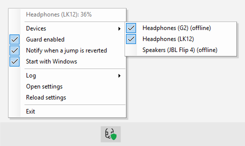

<div align="center">

<picture>
  <source media="(prefers-color-scheme: dark)" srcset="docs/icon-dark.png">
  
</picture>

# BtVolumeGuard

A Windows tray app that stops Bluetooth headsets from jumping to 100% volume when a call starts.

[](https://github.com/askrinnik/BtVolumeGuard/actions/workflows/ci.yml)
[](https://github.com/askrinnik/BtVolumeGuard/releases/latest)

[](https://dotnet.microsoft.com/download/dotnet/10.0)
[](LICENSE)

</div>

## The problem

On Windows, many Bluetooth headsets jump to **100% volume** every time a call starts. You set the playback volume to, say, 20%, join a Microsoft Teams (or Zoom, Google Meet, Discord…) meeting, and the volume goes to the maximum, again on every new meeting, so it has to be turned down by hand each time.

BtVolumeGuard was written for the **LK12** open-ear Bluetooth headset, where this happens on every Teams call on Windows 11, and is verified with it. The cause is generic, so it should help with other headsets that do the same.

### Why it happens

A classic Bluetooth headset has two audio profiles: **A2DP** (stereo, for music and video, no microphone) and **HFP** (Hands-Free, for calls). When a call app opens the headset microphone, Windows switches the headset to HFP. On the HFP connection the headset reports **maximum volume** to Windows (HFP volume sync, `AT+VGS`), and Windows applies it.

On older setups the two profiles show up as separate playback devices, e.g. `Headphones (LK12)` and `Headset (LK12 Hands-Free)`. On current Windows 11 they are one device, `Headphones (LK12)`, that switches profile inside; Windows even remembers a separate volume for calls, but the headset overrides it half a second later.

### What did not help

- **Disabling Bluetooth Absolute Volume** (`HKLM\SYSTEM\ControlSet001\Control\Bluetooth\Audio\AVRCP\CT\DisableAbsoluteVolume = 1`). The jump still happened, because Absolute Volume covers AVRCP/A2DP, not HFP. Also Windows could no longer control Bluetooth volume, only the headset buttons could. Reverted.
- **The headset manual.** The LK12 has no "remember volume" or similar setting, only volume buttons and a factory reset.
- **Avoiding HFP**: using the stereo device in the call app with another microphone, or disabling the Hands-Free service. This removes the jump, but the whole point of such a headset is its microphone, so this is not acceptable.

The jump is initiated by the headset itself, so Windows settings cannot prevent it. What remains is to **detect the jump and revert it immediately**.

## The solution

BtVolumeGuard runs in the system tray and guards **every Bluetooth playback device** by default; devices can be switched off one by one in the tray menu.

- At the start of a call Windows switches the headset to the call profile and sets the call volume it remembered; about half a second later the headset pushes 100%. BtVolumeGuard recognises that push by its Core Audio event context and restores the volume Windows had set.
- Any other single-step jump to the maximum (≥ 95%, by at least 20 points) from an unrecognised source is reverted too. This also covers headsets or Windows versions whose event contexts differ from the ones observed with the LK12; the contexts can be added in the settings file.
- Changes made by the user (keyboard, volume sliders, headset buttons) are never reverted, even a deliberate move to 100%.
- If a separate `Hands-Free` device appears already at 100%, the last known volume or a default of 20% is applied.

It reacts to Windows Core Audio notifications (via [NAudio](https://github.com/naudio/NAudio)) rather than polling, so the correction should be fast enough to go unnoticed. How the jump was analysed: [`docs/design.md`](docs/design.md).

Everything is in the tray menu (left or right click on the icon): the current headset volume, the **Devices** to guard (every Bluetooth playback device Windows knows; ones that are not connected are marked "(offline)"), turning the guard and revert notifications on or off, starting with Windows, the log level, and the log and settings files. The shield in the icon turns grey while the guard is off.

<p align="center">
  <picture>
    <source media="(prefers-color-scheme: dark)" srcset="docs/screenshots/tray-menu.png">
    
  </picture>
</p>

A working PowerShell prototype of the same idea is in [`prototype/LK12-VolumeGuard.ps1`](prototype/LK12-VolumeGuard.ps1) (polling every 100 ms, verified by simulating a jump; not yet verified on a real call).

## Status

Version 0.2.0, in daily use. Roadmap steps 1–6 and 8 are done (see [`docs/design.md`](docs/design.md)):

- The tray app reverts the jump at the start of a call. Verified with the LK12 on real Teams calls, also after the headset was switched off and on again. Not yet verified with other headsets; reports are welcome.
- Every Bluetooth playback device is guarded by default; the tray menu → Devices lists them (also the ones that are not connected) and lets you exclude some. The event contexts that identify the jump can be extended in the settings file.
- Reverted jumps are logged to `BtVolumeGuard.log` next to the executable (tray menu → Log: level, open, clear; level `Off`, `Normal` or `Verbose`, where `Verbose` also records every volume change with its event context).
- Settings and remembered volumes are stored as JSON next to the executable (`BtVolumeGuard.settings.json`, `BtVolumeGuard.state.json`).
- The tray menu shows the current headset volume and lets you turn the guard and revert notifications on or off, start the app with Windows, open the settings and reload them.
- It is published as a single-file exe; see [Install](#install).

Still open: whether the event contexts the guard relies on stay the same after a reboot and on other machines, and retiring the PowerShell prototype (roadmap step 7).

## Build and run

Requires the .NET 10 SDK, Windows 10/11.

```bash
dotnet build src
dotnet test src
dotnet run --project src/BtVolumeGuard
```

## Install

The app is a single `BtVolumeGuard.exe` (framework-dependent, needs the [.NET 10 Desktop Runtime](https://dotnet.microsoft.com/download/dotnet/10.0)). It keeps its settings, remembered volumes and log next to itself, so put it in a folder you can write to (not `Program Files`).

```powershell
.\tools\publish.ps1                                   # builds publish\BtVolumeGuard.exe
.\tools\publish.ps1 -InstallDir D:\Tools\BtVolumeGuard  # also copies it there (stops and restarts a running copy)
```

Ready-made builds: every CI run attaches `BtVolumeGuard.exe` as an artifact, and pushing a tag `v<version>` (e.g. `v0.1.1`) creates a [GitHub Release](https://github.com/askrinnik/BtVolumeGuard/releases) with the exe built for that version.

Start the installed exe once and use the tray menu → "Start with Windows" to run it at logon. Updating is the same `-InstallDir` command; settings and the log are kept.

## Repository layout

```
src/                           Self-contained C# solution: BtVolumeGuard.slnx, Directory.Build.props, .editorconfig
src/BtVolumeGuard.Core/        Logic and Core Audio access (NAudio), no UI
src/BtVolumeGuard/             WinForms tray app (WinExe)
src/BtVolumeGuard.Core.Tests/  xUnit tests for Core
.github/workflows/ci.yml       CI: build, tests, format check, publish; release on tag v*
tools/publish.ps1              Release build and install into a folder
tools/make-icon.ps1            Regenerates the executable's icon
prototype/                     PowerShell prototype
docs/design.md                 Requirements, design decisions, roadmap
```

## License

[MIT](LICENSE)
